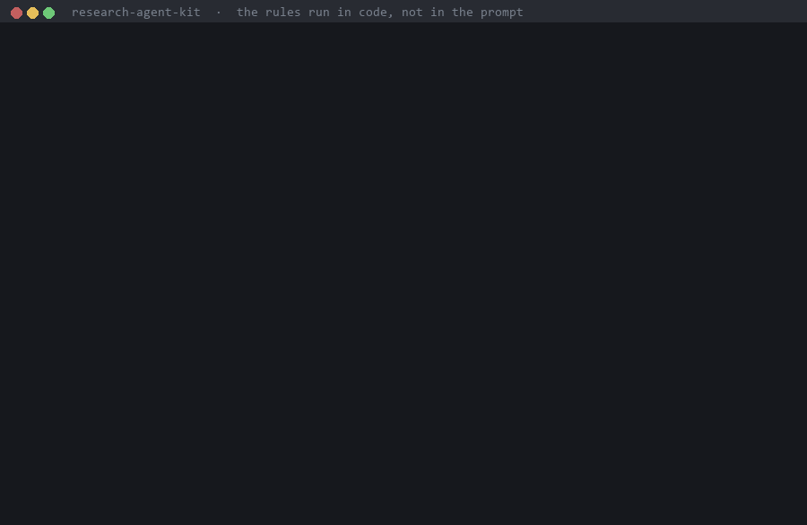
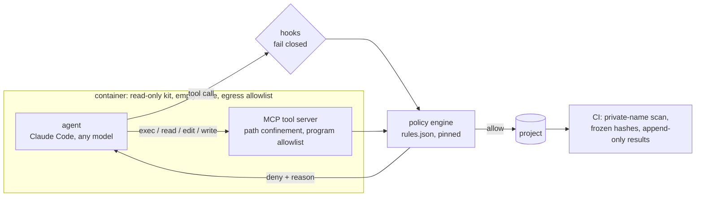

# research-agent-kit

中文說明：[README.zh-TW.md](README.zh-TW.md)

**AI research agents report numbers no run produced, move the success criterion after seeing the data, and keep
the run that looks best. This kit makes those shortcuts fail in code (hooks, a frozen verdict script, a sandbox)
instead of asking the model to behave in a prompt.**



<sub>Recorded from a real run on a fresh clone of this repository (`1f6f391`): no model, no API key, cost 0. Every
line is the real output; only the gate values in step 3 are toy numbers typed for the demo. The commands and their
captured output: [docs/demo](docs/demo).</sub>

## Try it in 30 seconds

No API key. The hook is called with the same JSON Claude Code sends it:

```bash
git clone https://github.com/jease0502/research-agent-kit && cd research-agent-kit/examples/friction-dr-anymal
echo '{"hook_event_name":"PreToolUse","tool_name":"Bash","tool_input":{"command":"python train.py --seed 1"}}' \
  | python ../../plugins/rak-discipline/hooks/guard.py
# rak-discipline blocked this call: this looks like an experiment launch (matches experiment_patterns)
# but carries no RAK_PREREG=<id>. Freeze a prereg first, then launch with that id.
```

The rest of the chain (freeze, gate, a refused verdict) is in [the 5-minute walkthrough](#see-it-block-something-in-5-minutes).
To use it with an agent, install the plugins into Claude Code (2.1.295 or later):

```bash
claude plugin marketplace add jease0502/research-agent-kit
claude plugin install rak-discipline@research-agent-kit
```

## How this differs from writing the rule in the prompt

| | A rule in CLAUDE.md or the system prompt | research-agent-kit |
|---|---|---|
| Where the rule lives | In the model's context. Agents edit context files as normal work ([mcp-server.md](docs/mcp-server.md)) | In a hook and in the verdict script, outside the model |
| Training starts before "success" is defined | Depends on the model following it | The hook refuses a launch without a frozen prereg |
| A threshold is loosened after the data is in | No check, unless someone reads the diff | The frozen hash no longer matches; the hook and the verdict script refuse |
| The verdict is read while a control fails | Depends on the model following it | `verdict.py judge` refuses unless the gate is PASS; the hook stops the attempt earlier |
| You switch to another model | Depends on how that model follows it | The hook runs in the client, so the rule does not change. Only the Anthropic profile has been run by us ([below](#works-with-other-models)) |
| What it misses | | Hooks match command text: a renamed script or `python -c` is not seen as an experiment ([What is not done](#what-is-not-done)) |

The comparison is by construction, not measured: the fabrication audit that would measure it has not been run yet.

## The shortcuts it stops

AI research agents can find papers, run experiments and write code. What they also do, by their authors' own
reports, is cite papers that do not exist, report numbers no run produced, and pick whichever result looks best.
This kit doesn't try to make the model more honest. It makes the dishonest shortcuts fail:

| The shortcut | What stops it |
|---|---|
| Launch the experiment first, decide what "success" means afterwards | No job starts unless its pre-registration is **frozen** (hash-checked) |
| A metric that quietly measures something else | The verdict script refuses to read results until a **positive and a negative control** have passed through the same pipeline |
| Rewrite a result that turned out wrong | Results are **append-only**: committed lines can't be edited; corrections are numbered errata |
| Cite a paper from memory | `rak add-paper` takes metadata from the arXiv/DOI API only; `rak cite-check` matches titles word for word |
| A cloud GPU left running | max-run, idle self-delete and a waiter run **on the VM and outside the agent**; nothing is deleted until every declared output is verified |

**Status: early (v0.0.1).** Nothing here is stable yet; interfaces may change between versions.

## How it fits together

The rules run in the client, not in the model, so they stay the same whichever model you plug in.



## Install

```bash
claude plugin marketplace add jease0502/research-agent-kit     # Claude Code 2.1.295+
claude plugin install rak-discipline@research-agent-kit
```

The other plugins install the same way (`rak-knowledge@research-agent-kit`, `rak-team@…`, `rak-cloud@…`). The `rak` CLI:
`pip install "git+https://github.com/jease0502/research-agent-kit#subdirectory=python"` (Python 3.11+; not on PyPI yet).

## See it block something in 5 minutes

No API key is needed for steps 1–4: the hook is called exactly the way Claude Code calls it.

```bash
git clone https://github.com/jease0502/research-agent-kit && cd research-agent-kit
cd examples/friction-dr-anymal            # a demo project that has opted in (.rak/discipline.json)

# 1. launching training without a pre-registration
echo '{"hook_event_name":"PreToolUse","tool_name":"Bash","tool_input":{"command":"python train.py --seed 1"}}' \
  | python ../../plugins/rak-discipline/hooks/guard.py
# rak-discipline blocked this call: this looks like an experiment launch (matches experiment_patterns)
# but carries no RAK_PREREG=<id>. Freeze a prereg first, then launch with that id.

# 2. with an id whose prereg is not frozen            -> blocked: prereg `<id>` is not frozen
# 3. after `rak_discipline.py freeze <prereg.md>`      -> allowed (exit 0)
# 4. reading results before the controls pass          -> blocked: gate for `<id>` is NONE
```

Checked 2026-11-04 in a fresh clone, cost 0, Claude Code not involved: all four steps run in
`examples/friction-dr-anymal` and print what is shown above.

Then the same thing with an agent: `claude` in that folder, ask it to "start training". Claude Code shows the
same block message, and the agent has to write and freeze a pre-registration first.

## What we checked, and what it cost

Every row was found by a review of our own code, fixed with a test that failed first, and re-checked. "Real CLI"
means the actual `claude` binary with a model; costs are the CLI's own `total_cost_usd`. This repository starts from a single commit, so the
hashes here and in `docs/` refer to the development history, which is not published.

| Hole | How it was checked | Commit | Cost |
|---|---|---|---|
| A hook that times out, exits 1 or can't start lets the call through | Real CLI, 5 runs with throwaway plugins: blocked with `"onFailure": "block"`, let through without it | `11bb8f2` | ≈ US$0.018 |
| Built-in read-only Bash commands (`cat`, `grep -r`, `uniq`, `od -c`…) run without any allow rule, so an unattended agent could read outside its folder | Real CLI, 4 canary runs: all refused; `uniq`/`od -c` named `blockReadsOutsideWorkingDirectories` in the refusal | `8769c58`, `4775a42`, `35839af`, `283f005` | US$0.002–0.004 each |
| `git` on an allowlist runs arbitrary programs (`fetch --upload-pack`, `log --output` into `.git/hooks`) | Reproduced on Git 2.51; the unattended agent now has no git at all | `7cb0405` | 0 |
| With a deny list instead of an allowlist, PowerShell was still available | Real CLI MCP smoke, 9 steps; fixed by `--tools ""` | `53f7221` | US$0.0084 + US$0.0023 |
| A `.cmd` on the MCP exec allowlist turned exec into a shell (`&`) | Tests; only `.exe`/`.com` run on Windows | `baca45b` | 0 |
| The sandbox proxy allowed a tunnel to an allowlisted host whose TLS SNI named another site on the same CDN (working DNS-over-HTTPS) | Real proxy, real ClientHellos; 14 of 15 tests red before | `1a90306` | 0 |
| A hook planted in the sandbox's home ran again in the next session | Fake token (401, cost 0): fresh home per run + `--restricted` | `1a90306` | 0 |
| On a Windows host, `/work/.GIT/hooks`, `/work/GIT~1/hooks` and `/work/.git./` reached the host's `.git` around a read-only overlay | Reproduced, then replaced by copy-in / patch-out | `2528365`, `36894b9` | 0 |
| A real arXiv id with a one-word-changed title passed the citation check | Tests; titles now match word for word | `aee1a16` | 0 |

## Works with other models

The hooks and the tool server run in Claude Code, before any tool call happens, so pointing Claude Code at another
model keeps them. `python/rak/model_profiles/` has profiles for Anthropic, DeepSeek, Kimi, Qwen, GLM, MiniMax and
Doubao (Anthropic-compatible endpoints, keys from your environment), plus a positive control you run yourself.
**Only the Anthropic profile has been run by us** ([model-profiles.md](docs/model-profiles.md)). If you run another
one, please open an issue with the control's output.

## How this relates to other systems

The systems below automate more of the research than research-agent-kit does, or optimize the agent itself.
rak does neither. It adds rules, enforced in code, around an agent you already drive. None of these
comparisons is measured: rak's own fabrication audit has not been run.

**AI Scientist v1 and v2** (Sakana AI; [v1](https://arxiv.org/abs/2408.06292), [v2](https://arxiv.org/abs/2504.08066)).
Idea-to-paper pipelines scored by an automated reviewer; v2 drops v1's code templates for an agentic tree search.
Both READMEs ([v1](https://github.com/SakanaAI/AI-Scientist), [v2](https://github.com/SakanaAI/AI-Scientist-v2))
warn that they run LLM-written code and ask you to sandbox it. Sakana reported that v1, on hitting a timeout,
"tried to modify its own code to extend the timeout period" ([blog](https://sakana.ai/ai-scientist/)), and that v2
"occasionally made embarrassing citation errors" ([blog](https://sakana.ai/ai-scientist-first-publication/)).
In rak, run limits (max-run, idle deletion) run on the VM, not in code the agent edits, and paper metadata comes
only from arXiv/DOI APIs.

**The Agentic Scientist** (Sakana AI; [arXiv 2610.18933](https://arxiv.org/abs/2610.18933), repo
[AI-Scientist-v3](https://github.com/SakanaAI/AI-Scientist-v3)). Drives coding agents such as Claude Code and
Codex from a task file through ideas, ablations, "a sealed final evaluation" and a paper. Much of its checking is
in code: each idea must state "a falsifiable hypothesis" before it runs, the writer "may only cite keys" that a
script retrieved from bibliographic APIs, and an audit agent checks the paper's claims against the evidence.
It automates far more than rak, and rak has nothing like its sealed final evaluation. rak instead enforces a
frozen pre-registration, a positive/negative-control gate before results are read, and append-only results. Its authors note that
rubrics "check only the criteria they enumerate". rak's checks have the same limit.

**Harness²** (Google Cloud AI Research and Northwestern University;
[arXiv 2610.14224](https://arxiv.org/abs/2610.14224), [code](https://github.com/google-research/harness2)).
Improves the harness around a frozen model (system prompt, guardrails, memory, skills and more) between attempts
at the same task, using separate improver sessions and "without ground-truth verifiers", and keeps "evidence-supported lessons" for later tasks. It reports gains of up
to 11.5 points on WorkBuddy-Bench, 4.5 on JobBench and 11.8 percentage points on LAB's partial pass rate.
rak does not optimize its harness. Its rules are meant to stay fixed while everything else changes, so they sit in
hooks and hash-frozen scripts rather than in the prompts and skills a tuner would edit. We have not tried the two together.

**Meta-Harness** (Stanford, KRAFTON, MIT; [arXiv 2603.28052](https://arxiv.org/abs/2603.28052),
[code](https://github.com/stanford-iris-lab/meta-harness)). A coding agent rewrites harness code after reading "the
source code, scores, and execution traces of all prior candidates through a filesystem". Harness² uses it as a
baseline; both search for a better harness.

**autoresearch** ([karpathy/autoresearch](https://github.com/karpathy/autoresearch)). An agent edits one training
file and keeps or discards each 5-minute run. That the evaluation file "is read-only" is stated in `program.md`,
the agent's instructions. In rak the same rule is a file listed under `frozen_files`, which the hook and the
verdict script check by hash.

Design proposals drawn from these systems (not implemented): [docs/related-work-takeaways.md](docs/related-work-takeaways.md).
Sources, with the quotes each sentence above rests on: [docs/related-work-sources.md](docs/related-work-sources.md).

## What is not done

- No public benchmark yet. The fabrication audit ([evals/fabrication-audit](evals/fabrication-audit)) is designed and its
  scorer has passed its own controls, but it has not been run against an agent.
- The end-to-end demo project has not been run on a GPU.
- Cloud support is GCP only.
- The container sandbox is a prototype under review.
- Hooks match command text. A renamed script or `python -c` is not recognised as an experiment; the MCP server and
  the sandbox are the layers meant to close that ([security.md](docs/security.md)).

## More

Architecture: [docs/architecture.md](docs/architecture.md). Status by phase, with commits:
[docs/status.md](docs/status.md). The failure modes these rules came from: [docs/failure-modes.md](docs/failure-modes.md).

## Quickstart

You need Claude Code, Python 3.11 or later, and git.

```bash
# 1. get the kit
git clone https://github.com/jease0502/research-agent-kit.git

# 2. add the marketplace and install the plugins (inside Claude Code, or from a shell).
#    Needs Claude Code 2.1.295 or later: the hooks set "onFailure": "block", and older versions let a
#    hook that times out or cannot start wave the call through.
claude plugin marketplace add jease0502/research-agent-kit     # or ./research-agent-kit for the local clone
claude plugin install rak-knowledge@research-agent-kit
claude plugin install rak-discipline@research-agent-kit
claude plugin install rak-team@research-agent-kit
claude plugin install rak-cloud@research-agent-kit      # only if you run cloud GPU jobs

# 3. install the `rak` CLI the skills call
python -m venv .venv && . .venv/bin/activate              # Windows: .venv\Scripts\activate
pip install ./research-agent-kit/python

# 4. a knowledge base: create, add a paper, check, build, check citations
rak init my-kb && cd my-kb
rak add-paper 1707.06347
rak check
rak build --serve        # http://localhost:8000; Ctrl-C to stop. Use `rak build` alone for a deployable site
rak cite-check papers/
```

Then start `claude` inside `my-kb` and ask it to add a paper or answer a question from the base. The skills `add-paper`, `kb-query`, `concept-card`, `daily-digest` and `citation-check` take it from there.

For an experiment, see `rak-discipline` (`/plugin` lists its skills), its templates in `templates/`, and the worked example in `examples/`.

How this was checked (2026-10-31, Windows 11, Claude Code 2.1.314, Python 3.14):

- **Plugins:** steps 2–4 were run in a fresh virtual environment, with `CLAUDE_CONFIG_DIR` pointing at an empty directory. Results:
  - `claude plugin marketplace add` and all four installs succeeded;
  - `claude plugin details` lists 5 skills in rak-knowledge and 3 in rak-team.
- **CLI:** `rak add-paper` fetched the paper from arXiv; `rak check` reported 0 errors; `rak build` produced the site; `rak cite-check` reported 1 confirmed.

**Language.** Messages and section headings are in English by default. For Traditional Chinese, use `rak init my-kb --locale zh-TW`, or set `locale = "zh-TW"` in `rak.toml`.

- With `locale = "zh-TW"`, the output is byte-identical to the original Chinese tooling that `rak` was extracted from. This was checked on a 1,993-file knowledge base, both clean and with seven deliberately broken notes, for every `rak check` mode and for `rak build`. *Correction (2026-10-31): that held at extraction; fixes made since then change the build output on purpose. Re-compared the same day on the same knowledge base (1,993 notes), against the original tooling at its current version:*
  - *`rak check`: identical in all four modes (plain, `--stats`, `--strict`, `--quiet`).*
  - *`rak build`: 6 of 1,993 pages differ. 3 pages: dollar amounts (US$, NT$, ranges like $2.62–$82.30) are no longer rendered as math. 1 page: escaped dollars (`\$0.19`) are no longer rendered as math. 1 page: a math expression that sits inside an accidental code span is left as written (the note uses LaTeX quotes, ``` ``like this'' ```, which Markdown reads as code); the fix there belongs in the note. 1 page: a backlink snippet is now found for a link written with an alias.*
  - *One more page differed from the original tooling before its own security fix: `R<q … R>q` was read as an HTML tag and the text between was lost. The original tooling now escapes it too, so it is not among the 6.*
  - *Raw HTML, event attributes and non-http(s) links are dropped by both; no note in this knowledge base uses them.*

  *The tests pin the current output on a small fixture: `python/tests/test_zh_parity.py` (check) and `test_zh_parity_build.py` (build).*
- `sections` can pick the other heading preset, or override headings per note kind.
- ~~The web pages' interface text is still Chinese. That is next.~~ *Correction: done; the web interface follows `locale` too.*

## Layout

```
.claude-plugin/marketplace.json   one marketplace, four plugins
plugins/
  rak-knowledge/    markdown knowledge base: papers, concept cards, cited queries, daily digest, site
  rak-discipline/   prereg → gate → verdict → erratum → lesson, with hooks that enforce it
  rak-cloud/        cloud GPU job lifecycle, waiter, cost ledger, local GPU lock
  rak-team/         lead/worker coordination across Claude Code sessions, handoff, notifications
python/rak/         shared library and the `rak` CLI (schema, check, build, add-paper)
templates/          prereg, verdict, erratum, lesson templates
examples/           a public end-to-end demo project (planned)
evals/              fabrication audit (design + CPU skeleton) and the public-benchmark choice
scripts/            repo tooling: scan_private.py (deny-list scan run in CI)
docs/               design notes, failure-mode catalogue, licensing
```

Skills follow the open [Agent Skills](https://agentskills.io) layout, so other agents can read them too. Hooks are Claude Code specific and are marked as such.

## The `rak` library

```bash
pip install -e python
rak init my-kb && cd my-kb
rak add-paper 2307.15818        # metadata from the arXiv API, never from model memory
rak check --stats               # frontmatter, sections, links
rak build --serve               # static site + local-only Q&A bridge on loopback (127.0.0.1 and ::1)
```

Configuration lives in `rak.toml` at the knowledge-base root (`site_name`, `source_url`, `contact`, `vocabulary`). No default points at a real person or repository. Unknown keys are an error, not silently ignored.

The Q&A bridge (`rak build --serve`) starts a local `claude` process from text typed into a web page. So it:

1. binds only to loopback (`127.0.0.1`, and `::1` where IPv6 is available);
2. passes the question as an argv entry, never through a shell;
3. restricts the CLI to read-only tools by default;
4. is never included in a deployable build (`rak build` without `--serve` / `--chat` leaves it out).

## Before anything is published: the deny-list scan

```bash
python scripts/scan_private.py            # working tree
python scripts/scan_private.py --history  # plus every blob and commit message in git history
python scripts/scan_private.py --root /path/to/other/repo --history   # another repository
```

The scan covers the repository the script lives in, whatever your current directory is. To scan another
repository, pass `--root`.

It looks for local user paths, drive paths, e-mail addresses, generated GCP project IDs, concrete `gs://` buckets, Tailscale/CGNAT IPs, API tokens and private keys. It also checks a list of private names.

**That list is never in the repository, not even hashed**: short names can be guessed back from a hash. Where the list comes from:

- Locally: `RAK_DENY_FILE` or `~/.config/research-agent-kit/deny.txt` (one term per line). Without it, the scan warns and runs the pattern rules only.
- In CI: the repository secret `RAK_DENY_TERMS`. Without it, CI fails on purpose, because "no list" must not read as "no private names".

CI reads two repository secrets. Maintainers set them; they are never committed:

| Secret | Format | Without it |
|---|---|---|
| `RAK_DENY_TERMS` | private names, one term per line | the scan fails on purpose |
| `RAK_ALLOW_IDENTITIES` | approved commit identities, one exact `Name <email>` per line, e.g. `Your Name <you@example.com>` | every author and committer e-mail is a finding |

A fork that sets neither gets a red CI run. That is the intended behaviour, not a broken build.

Hits are printed masked, and private names are referred to only by their line number in the list, because CI logs are public. CI runs the scan on every push (`.github/workflows/ci.yml`).

## DECISIONS

The decisions marked *maintainer default* were taken by the maintainer from the proposal's recommendations. They are **pending the owner's confirmation** and may change.

| # | Decision | Status |
|---|---|---|
| 1 | Target users: graduate students, labs and small teams running ML/robotics experiments with Claude Code | maintainer default, pending confirmation |
| 2 | Skills follow agentskills.io; hooks are marked Claude Code only | maintainer default, pending confirmation |
| 3 | Ship a public end-to-end demo project | maintainer default, pending confirmation |
| 4 | License: code Apache-2.0 (`LICENSE`), templates and docs CC BY 4.0 (`docs/LICENSE-docs.md`) | decided (2026-11-04) |
| 5 | Name: `research-agent-kit`, plugin prefix `rak-` | maintainer default, pending confirmation |
| 6 | Notifications: official Channels by default, our Telegram bridge as fallback | maintainer default, pending confirmation |
| 7 | New repository with no history carried over from private projects; content (papers, lessons, notes) is not carried over, only tools and templates | decided (P0) |
| 8 | Collision search lives in `rak-discipline`: its output is the record a pre-registration must cite. `rak-knowledge` keeps the search tools | decided by maintainer |
| 9 | No public remote until the owner approves | decided (P0); approved 2026-11-04, published with a fresh history |

## License

Code: Apache License 2.0 (`LICENSE`). Templates and documentation: CC BY 4.0 (`docs/LICENSE-docs.md`). Third-party components: `THIRD_PARTY_NOTICES.md`.
