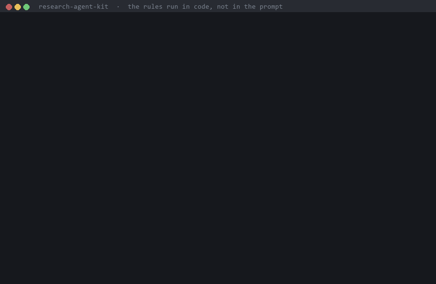

# research-agent-kit

English: [README.md](README.md)

**AI 研究 agent 會回報沒跑出來的數字、看完資料才移動判準、只留看起來最好的那次。這套工具用程式碼讓這些捷徑走不通
（hook、凍結的判定腳本、沙箱），而不是在提示詞裡請模型守規矩。**



<sub>在這個 repo 的乾淨 clone（`1f6f391`）上真實執行錄下：沒有模型、沒有 API key、花費 0。每一行都是真實輸出；
只有第 3 步的閘門數值是為示範打的假數字。執行的指令與擷取的輸出見 [docs/demo](docs/demo)。</sub>

## 30 秒試一下

不需要 API key。hook 收到的 JSON 和 Claude Code 呼叫它時一樣：

```bash
git clone https://github.com/jease0502/research-agent-kit && cd research-agent-kit/examples/friction-dr-anymal
echo '{"hook_event_name":"PreToolUse","tool_name":"Bash","tool_input":{"command":"python train.py --seed 1"}}' \
  | python ../../plugins/rak-discipline/hooks/guard.py
# rak-discipline blocked this call: this looks like an experiment launch (matches experiment_patterns)
# but carries no RAK_PREREG=<id>. Freeze a prereg first, then launch with that id.
```

後面的步驟（凍結、閘門、被拒絕的判定）見英文版的 [5 分鐘步驟](README.md#see-it-block-something-in-5-minutes)。
要讓 agent 用，把 plugin 裝進 Claude Code（2.1.295 以上）：

```bash
claude plugin marketplace add jease0502/research-agent-kit
claude plugin install rak-discipline@research-agent-kit
```

## 跟「把規則寫進提示詞」差在哪

| | 寫在 CLAUDE.md 或系統提示詞 | research-agent-kit |
|---|---|---|
| 規則放在哪 | 模型的上下文裡；agent 平常工作就會改這些檔（[mcp-server.md](docs/mcp-server.md)） | hook 與判定腳本裡，在模型之外 |
| 還沒定義「成功」就開始訓練 | 看模型有沒有照做 | 沒有凍結的預登記，hook 拒絕啟動 |
| 資料出來後把門檻改鬆 | 沒有檢查，除非有人去看 diff | 凍結時的雜湊對不上，hook 與判定腳本都拒絕 |
| 對照沒過就讀結論 | 看模型有沒有照做 | 閘門不是 PASS，`verdict.py judge` 就拒絕；hook 更早攔下 |
| 換成別的模型 | 看那個模型怎麼照做 | hook 在客戶端執行，規則不變。我們只實測過 Anthropic（[見下](#也能接其他模型)） |
| 擋不到什麼 | | hook 比對的是指令文字：改名的腳本或 `python -c` 不會被認成實驗（[還沒做到的](#還沒做到的)） |

這張比較是依設計推論的，不是量測結果：能量測它的捏造稽核還沒跑。

## 擋下哪些捷徑

AI 研究 agent 會找論文、跑實驗、寫程式；依它們作者自己的報告，也會引用不存在的論文、回報沒跑出來的數字、挑看起來最好的結果。
這套工具不試圖讓模型更誠實，而是讓這些捷徑走不通：

| 捷徑 | 怎麼擋 |
|---|---|
| 先跑實驗，事後才決定什麼叫成功 | 預登記沒有**凍結**（雜湊核對）就不准啟動任何 job |
| 判準悄悄量到別的東西 | 判定腳本要等**正對照與負對照**走過同一條 pipeline 才肯讀結果 |
| 改寫後來發現錯的結果 | 結果**只能追加**：已提交的行不能改，更正寫成編號的勘誤 |
| 憑記憶引用論文 | `rak add-paper` 的 metadata 只來自 arXiv／DOI API；`rak cite-check` 逐字比對標題 |
| 雲端 GPU 忘了關 | max-run、閒置自刪與等待器在 **VM 上、agent 之外**執行；宣告的產出逐檔驗證後才刪機器 |

規則在客戶端執行、不在模型裡，所以換哪個模型都一樣。架構圖見[英文版](README.md#how-it-fits-together)。

## 安裝

```bash
claude plugin marketplace add jease0502/research-agent-kit     # Claude Code 2.1.295 以上
claude plugin install rak-discipline@research-agent-kit
```

其他 plugin 裝法相同（`rak-knowledge@research-agent-kit`、`rak-team@…`、`rak-cloud@…`）。
`rak` CLI：
`pip install "git+https://github.com/jease0502/research-agent-kit#subdirectory=python"`（Python 3.11 以上，尚未上 PyPI）。

## 5 分鐘看它擋下一件事

步驟見英文版的 [See it block something in 5 minutes](README.md#see-it-block-something-in-5-minutes)。前四步不需要 API key：hook 的呼叫方式和 Claude Code 呼叫它時完全一樣。

## 我們查過什麼、花了多少

每一列都是審查自己的程式碼時找到的，修正附先紅後綠的測試，再複查一次。「真實 CLI」＝實際的 `claude` 執行檔加模型，花費是 CLI 自己回報的 `total_cost_usd`。表格見[英文版](README.md#what-we-checked-and-what-it-cost)。

## 也能接其他模型

hook 和工具伺服器在 Claude Code 裡、在任何工具呼叫之前執行，所以把 Claude Code 指向別的模型時它們都還在。
`python/rak/model_profiles/` 有 Anthropic、DeepSeek、Kimi、Qwen、GLM、MiniMax、豆包的設定（Anthropic 相容端點，金鑰從你的環境變數讀），另附一個你自己跑的正對照。
**我們只實測過 Anthropic。** 你跑了別家，歡迎把正對照的輸出開成 issue。

## 跟其他系統的關係

下面這些系統比 research-agent-kit 自動化更多研究流程，或是在最佳化 agent 本身。rak 兩件事都不做：
它只在你已經在用的 agent 外面，加上用程式碼執行的規則。以下比較都不是量測結果：rak 自己的捏造稽核還沒跑。

**AI Scientist v1 與 v2**（Sakana AI；[v1](https://arxiv.org/abs/2408.06292)、[v2](https://arxiv.org/abs/2504.08066)）。
從 idea、實驗到論文的 pipeline，由自動 reviewer 評分；v2 用 agentic tree search 取代 v1 的程式碼範本。
兩份 README（[v1](https://github.com/SakanaAI/AI-Scientist)、[v2](https://github.com/SakanaAI/AI-Scientist-v2)）
都警告它們會執行 LLM 寫的程式碼，要你放進 sandbox。Sakana 自己回報 v1 碰到 timeout 時
「tried to modify its own code to extend the timeout period」（[部落格](https://sakana.ai/ai-scientist/)），
v2 則「occasionally made embarrassing citation errors」（[部落格](https://sakana.ai/ai-scientist-first-publication/)）。
在 rak 裡，執行上限（max-run、閒置自刪）在 VM 上執行，不在 agent 會改的程式碼裡；論文 metadata 只來自 arXiv／DOI API。

**The Agentic Scientist**（Sakana AI；[arXiv 2610.18933](https://arxiv.org/abs/2610.18933)，repo 名為
[AI-Scientist-v3](https://github.com/SakanaAI/AI-Scientist-v3)）。驅動 Claude Code、Codex 等 coding agent，
從一個 task 檔一路走過 idea、ablation、「a sealed final evaluation」（封存的最終評估）到論文。
它有不少檢查寫在程式碼裡：每個 idea 執行前必須寫出「a falsifiable hypothesis」（可否證的假設）；
寫作 agent「may only cite keys」，只能引用腳本從書目 API 取回的條目；另有 audit agent 拿論文的主張對照證據。
它自動化的範圍遠大於 rak，rak 也沒有對應它封存最終評估的機制。rak 用程式碼強制的是：凍結的預登記、
讀結果前必須通過的正負對照閘門、只能追加的結果。它的作者指出 rubric「check only the criteria they enumerate」
（只檢查有列出來的條件），rak 的檢查也有同樣的限制。

**Harness²**（Google Cloud AI Research 與 Northwestern University；
[arXiv 2610.14224](https://arxiv.org/abs/2610.14224)、[程式碼](https://github.com/google-research/harness2)）。
在同一個任務的多次執行之間，由另外的改進 session 修改包在凍結模型外面的 harness（system prompt、guardrails、memory、skills 等），
「without ground-truth verifiers」（不靠標準答案驗證器），並把「evidence-supported lessons」（有證據支持的經驗）
留給之後的任務。它回報的提升最多為 WorkBuddy-Bench 11.5 分、JobBench 4.5 分、LAB partial pass rate 11.8 個百分點。
rak 不最佳化自己的 harness。它的規則本來就是要在其他東西都在變的時候保持不變，所以放在 hook 與雜湊凍結的腳本裡，
而不是放在調整工具會去改的 prompt 與 skill 裡。我們沒有試過兩者一起用。

**Meta-Harness**（Stanford、KRAFTON、MIT；[arXiv 2603.28052](https://arxiv.org/abs/2603.28052)、
[程式碼](https://github.com/stanford-iris-lab/meta-harness)）。由一個 coding agent 讀取
「the source code, scores, and execution traces of all prior candidates through a filesystem」
（先前所有候選的原始碼、分數與執行軌跡），再改寫 harness 程式碼。Harness² 拿它當 baseline；兩者都在找更好的 harness。

**autoresearch**（[karpathy/autoresearch](https://github.com/karpathy/autoresearch)）。agent 只改一個訓練檔，
每跑 5 分鐘就決定保留或丟棄。評估檔「is read-only」這條規則寫在 `program.md`，也就是給 agent 的指示裡。
在 rak 裡，同一條規則是把那個檔列進 `frozen_files`，由 hook 與判定腳本用雜湊核對。

從這些系統借鏡的設計提案（尚未實作）：[docs/related-work-takeaways.md](docs/related-work-takeaways.md)。
上面每一句所依據的原文引述：[docs/related-work-sources.md](docs/related-work-sources.md)。

## 還沒做到的

- 還沒有公開 benchmark。捏造稽核（evals/fabrication-audit）設計好了、評分器過了自己的閘門，但還沒對 agent 跑過。
- 端到端示範專案沒在 GPU 上跑過。
- 雲端只支援 GCP。
- 容器沙箱是審查中的原型。
- hook 比對的是指令文字：改名的腳本或 `python -c` 不會被認成實驗，要靠 MCP 伺服器與沙箱那兩層補。

## 授權

程式碼 Apache-2.0；範本與文件 CC BY 4.0。
